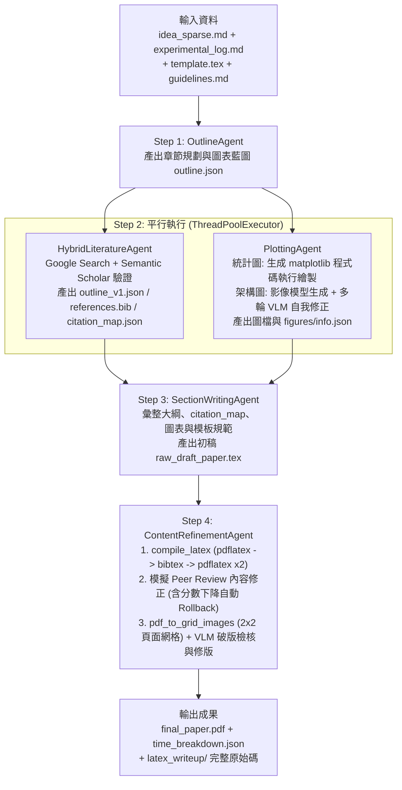

# 🎻 PaperOrchestra 繁體中文完整指南與本地使用教學

> 本文件整理自實際專案原始碼（`paper_writing_cli.py`、`methods/`、`utils/`）與對話脈絡，協助你在本地端快速理解、安裝、執行 **PaperOrchestra**，並將其封裝或移植為 AI Agent 的可複用技能（Skill）。

---

## 1. 專案定位與核心概念

### 與一般「AI Scientist」有什麼不同？
市面上許多「端到端 AI Scientist」標榜從零開始發想點子、寫程式跑實驗再寫論文；但在真實研發場景中，研究員與工程師往往**已經完成實驗、手邊有零散的筆記與數據**，最耗時且痛苦的是**「最後一哩路」——把零散材料整理成格式嚴謹、圖表齊全、文獻真實且不破版的 LaTeX 完稿**。

**PaperOrchestra** 正是為了這件事而設計的自動化寫作框架。你只要提供：
1. **凌亂的想法與方法筆記**（例如 `idea_sparse.md`）
2. **原始實驗數據與紀錄**（例如 `experimental_log.md`）
3. **目標會議／期刊的 LaTeX 模板與規範**（例如 `templates/cvpr2025` 或 `templates/iclr2025`）

它就會在背景調度 5 個專業分工的 Agent，自動產出可編譯的 `.tex` 原始檔、驗證過的 `.bib` 文獻庫、圖表與最終的 `final_paper.pdf`。

---

### 它是「框架」還是「技能（Skill）」？

**PaperOrchestra 本身是一個獨立的多 Agent Python 執行框架（CLI 工具），而不是單純給對話助手讀取的 `SKILL.md` 技能檔。**

| 面向 | PaperOrchestra（獨立框架） | AI Agent Skill（`SKILL.md`） |
| :--- | :--- | :--- |
| **本質** | 獨立執行的 Python 程式（`paper_writing_cli.py`） | 給主對話 AI 助手遵循的標準作業程序與輔助工具包 |
| **驅動方式** | 執行 CLI 後由程式自行透過 API 呼叫 LLM / VLM 跑完迴圈 | 由當前對話中的 AI Agent 讀取指引並逐步執行工作 |
| **API 消耗** | 自動執行多輪規劃、文獻搜尋、繪圖與審稿修正，外部 API 呼叫量較大 | 可直接呼叫本機 CLI，或借鏡其提示詞由當前 Agent 輕量分段執行 |
| **結合方式** | 可透過本倉庫附帶的 [`skills/paper-orchestra/SKILL.md`](../skills/paper-orchestra/SKILL.md) 包裝成技能，讓 AI 助手在對話中替你準備原料並觸發本機管線，或以輕量模式移植執行。 |

---

## 2. 內部 5 大 Agent 協作架構與資料流

在啟用繪圖模式（`--use_plotting true`，對應 `methods/paper_writer_with_plotting.py`）時，完整流水線如下：



*(註：若 `--use_plotting false`，管線會走 `methods/paper_writer.py`，跳過 `PlottingAgent` 並直接使用 `raw_materials_dir/figures/` 中預先提供的圖檔。)*

### 各階段元件詳解

1. **Step 1 — `OutlineAgent` (`methods/agents/outline_agent.py`)**
   * 讀取 `idea_sparse.md`、`experimental_log.md`、`template.tex` 與 `guidelines.md`。
   * 產出結構化的 `outline.json`，定義各章節要涵蓋的論點與 `plotting_plan`（圖表規劃藍圖）。

2. **Step 2 — 平行執行 (`ThreadPoolExecutor`)**
   * **`HybridLiteratureAgent` (`methods/agents/literature_review_agent.py`)**：
     * 透過 Google Search 探索候選論文，並呼叫 **Semantic Scholar API**（`utils/scholar_utils.py` 中的 `s2_title_search`）逐一核對標題、作者、年份與摘要，**杜絕 LLM 捏造假文獻**。
     * 依據 `--research_cutoff`（格式 `YYYY-MM`）過濾超越時間截點的論文，避免「時間穿越」引用。
     * 撰寫對應文獻回顧內容並產出 `outline_v1.json`、`updated_template.tex`、`references.bib` 與 `citation_map.json`。
   * **`PlottingAgent` (`methods/agents/plotting_agent.py`)**：
     * 當 `--use_plotting true` 時啟動，整合 `utils/paper_banana_utils.py` 依圖表類型分工：
       * **統計數據圖 (`plot`)**：由 LLM 撰寫 Python `matplotlib` 繪圖腳本並執行產圖。
       * **概念／系統架構圖 (`diagram`)**：由影像模型（預設 `gemini-3-pro-image-preview`）繪製。
     * 生成後會進行最多 `--plotting_max_critic_rounds`（預設 `3` 輪）的視覺自我檢查與重繪，並自動產出圖說（Caption）與 `figures/info.json`。

3. **Step 3 — `SectionWritingAgent` (`methods/agents/section_writing_agent.py`)**
   * 綜合 `outline_v1.json`、`citation_map.json`（確保只使用已驗證的 `\cite{key}`）、`figures/info.json`、原始實驗數據與會議規範，撰寫各章節 LaTeX 內文，產出初稿 `raw_draft_paper.tex`。

4. **Step 4 — `ContentRefinementAgent` (`methods/agents/content_refinement_agent.py`)**
   * **LaTeX 編譯**：透過 `utils/pdf_utils.py` 的 `compile_latex`，執行 `pdflatex` ➔ `bibtex` ➔ `pdflatex` ➔ `pdflatex` 完成交叉引用與參考文獻編譯。
   * **模擬審稿與防退化（Rollback）**：透過 `autoraters/agent_review.py` 對目前 PDF 進行模擬 Peer Review 打分，進行最多 `3` 輪內容修訂（`max_reflections=3`）。若修訂後的 `Overall` 分數下降，或總分持平但子指標退步總和大於進步總和，會自動拒絕該次修改並回退至前一有效版本。
   * **視覺破版檢查（VLM Formatting Loop）**：使用 `pdf_to_grid_images` 將 PDF 頁面拼成 2×2 網格圖，交由視覺語言模型（VLM）檢查圖表重疊、表格超出欄寬或版面異常等問題，並在不更動實質文字與數據的前提下修正 LaTeX 排版。最終將成果輸出至 `final_paper.pdf` 並記錄耗時於 `time_breakdown.json`。

---

## 3. 四大實際應用場景

1. **研究人員／碩博士生的「論文初稿加速器」**
   實驗做完、手邊已經有數據與筆記，但面對空白 `.tex` 不知從何下筆時，可用於快速生成結構完整、含圖表與排版合規的論文初稿，再由人類集中精力精修核心論述。
2. **獨立作為「無幻覺文獻回顧（Related Work）與 `.bib` 整理工具」**
   即使不讓框架撰寫整篇論文，`HybridLiteratureAgent` 的檢索＋Semantic Scholar 交叉比對邏輯也可單獨用來幫特定研究題目蒐集真實文獻、整理 `references.bib` 與撰寫文獻綜述草稿。
3. **借鏡或改造成「工程技術報告／計畫書自動產製系統」**
   將架構中的論文模板換成工程報告書模板，輸入材料改為現勘紀錄、試算結果與法規條文，即可套用相同的流水線——尤其「轉出 PDF ➔ 拼成網格圖交給 VLM 檢查破版／壓字」的機制，非常適合直接復用於各類自動出圖與報告品管流程。
4. **長文生成系統評測基準（`PaperWritingBench`）**
   搭配本專案論文所提出的評測指標與 `autoraters/` 目錄下的自動評估腳本（如引用 F1 分數、文獻回顧品質、Side-by-Side 評比），可用來量化測試不同 LLM 或自建寫作 Agent 的長文生成品質。

---

## 4. 本地端（Windows / Linux / macOS）完整安裝與使用指南

### 4.1 前置環境需求

1. **Python 3.11**：建議使用 Conda 或 `venv` 建立獨立環境。
2. **LaTeX 編譯環境（必要）**：因為管線在審稿與排版檢查階段會實際呼叫 `pdflatex` 與 `bibtex` 編譯 PDF。
   * **Windows**：推薦安裝 [MiKTeX](https://miktex.org/download)（建議勾選自動安裝缺失巨集套件）或 [TeX Live](https://www.tug.org/texlive/)。
   * **Linux (Ubuntu/Debian)**：可安裝 `texlive-full`（或至少包含 `pdflatex`、`bibtex` 及常用會議樣式套件）。
   * **驗證方式**：在終端機執行以下命令確認已加入系統 `PATH`：
     ```bash
     pdflatex --version
     bibtex --version
     ```

### 4.2 下載專案與安裝 Python 套件

```bash
git clone https://github.com/tutumomo/paper-orchestra.git
cd paper-orchestra

conda create -n paper_orchestra python=3.11 -y
conda activate paper_orchestra
pip install -r requirements.txt
```

### 4.3 設定環境變數 `.env`

在專案根目錄建立 `.env` 檔案（程式透過 `python-dotenv` 自動載入）：

```env
# Gemini 設定（二選一即可；若兩者皆有設定，程式優先採用 Vertex AI）
GEMINI_API_KEY=your_gemini_api_key
# VERTEX_AI_PROJECT=your_vertex_ai_project
# VERTEX_AI_LOCATION=your_vertex_ai_location

# OpenAI 設定（選填，僅切換至 OpenAI 後端時需要）
OPENAI_API_KEY=your_openai_api_key

# Semantic Scholar API Key（建議填寫，未填仍可嘗試查詢但容易受限於公開速率限制）
SEMANTIC_SCHOLAR_API_KEY=your_semantic_scholar_api_key

# 若透過 Streamlit Demo 執行並在完成後寄送通知信，再設定以下兩項（選填）
SMTP_EMAIL=your_email
SMTP_PASSWORD=your_password
```

### 4.4 準備輸入原料資料夾 (`raw_materials_dir`)

建立一個資料夾（例如 `my_inputs/`），裡面放置你的研究原始資料：

```text
my_inputs/
├── idea_sparse.md          # 核心動機、問題定義、提出方法概述（可用 --idea_filename 修改檔名）
├── experimental_log.md     # 實驗環境、數據表格、消融實驗與結果觀察（可用 --experimental_log_filename 修改檔名）
└── figures/                # 【選填】若設定 --use_plotting false，請將現成的 .pdf/.png/.jpg 圖檔放在此處
```

### 4.5 CLI 執行指令範例

#### Windows (PowerShell)
```powershell
python paper_writing_cli.py `
  --raw_materials_dir .\my_inputs `
  --latex_template_dir .\templates\cvpr2025 `
  --output_dir .\my_output_paper `
  --use_plotting true
```

#### Linux / macOS (Bash)
```bash
python paper_writing_cli.py \
  --raw_materials_dir ./my_inputs \
  --latex_template_dir ./templates/cvpr2025 \
  --output_dir ./my_output_paper \
  --use_plotting true
```

*(若沒有啟用自動繪圖，可省略 `--use_plotting true` 或設為 `false`，並確保 `./my_inputs/figures/` 內已有對應圖檔。)*

### 4.6 `paper_writing_cli.py` 完整參數對照表

| 參數名稱 | 必填 | 預設值 | 說明 |
| :--- | :---: | :--- | :--- |
| `--raw_materials_dir` | ✅ | - | 存放原始輸入檔案（`idea`、`experimental_log` 等）的資料夾路徑 |
| `--latex_template_dir` | ✅ | - | LaTeX 會議模板資料夾路徑（如 `templates/cvpr2025`、`templates/iclr2025`，需含 `template.tex` 與 `guidelines.md`） |
| `--output_dir` | ❌ | `./paper_output_YYYYMMDD_HHMMSS` | 輸出成果目錄；未指定時會自動以時間戳記命名建立 |
| `--idea_filename` | ❌ | `idea_sparse.md` | 位於 `--raw_materials_dir` 內的構想筆記檔名 |
| `--experimental_log_filename` | ❌ | `experimental_log.md` | 位於 `--raw_materials_dir` 內的實驗紀錄檔名 |
| `--use_plotting` | ❌ | `False` | 是否啟用 `PlottingAgent` 自動產生數據圖與架構圖（接受 `true`/`1`/`yes`） |
| `--writer_model_name` | ❌ | `gemini-3.1-pro-preview` | 用於大綱、文獻回顧與章節撰寫的模型名稱 |
| `--reflection_model_name` | ❌ | `gemini-3.1-pro-preview` | 用於模擬審稿與視覺排版檢核的模型名稱 |
| `--plotting_model_name` | ❌ | `gemini-3.1-pro-preview` | 用於 `PlottingAgent` 繪圖規劃、Python 繪圖程式碼生成與批改的模型 |
| `--image_model_name` | ❌ | `gemini-3-pro-image-preview` | 用於 `PlottingAgent` 生成架構／概念圖（`diagram`）的影像模型 |
| `--research_cutoff` | ❌ | 執行當下 `YYYY-MM` | 文獻檢索的時間截止年月（例如 `2024-11`），過濾晚於此時間的論文 |
| `--plotting_max_critic_rounds` | ❌ | `3` | `PlottingAgent` 針對單張圖表進行視覺自我修正的最大輪數 |

### 4.7 啟動 Streamlit 互動式 Web 介面

除了命令列外，專案也提供本地 Web Demo 介面（詳細操作與背景進程清理請見 [`frontend/README.md`](../frontend/README.md)）：

```bash
conda activate paper_orchestra
streamlit run frontend/app.py
```

啟動後依終端機顯示的網址（通常為 `http://localhost:8501`）在瀏覽器開啟即可透過介面操作與檢視進度。

---

## 5. 輸出資料夾產物說明

執行完成後，`--output_dir` 目錄內會包含以下重要檔案：

* `final_paper.pdf`：經過內容審稿與視覺排版修正後的最終 PDF 完稿。
* `outline.json`：大綱、章節重點與繪圖規劃藍圖。
* `literature_agent_output/`：包含驗證後的文獻資料 `citation_map.json`、`references.bib` 與更新後的模板。
* `latex_writeup/`：最終可獨立編譯的 LaTeX 專案資料夾（含 `.tex`、`.bib`、`figures/`）。
* `content_refinement_workdir/`：保留每一輪模擬審稿報告（`peer_reviews/`）、2×2 頁面檢查截圖（`pdf_screenshots/`）與修訂日誌。
* `time_breakdown.json`（啟用繪圖模式時）：記錄各 Agent 階段耗時統計。
